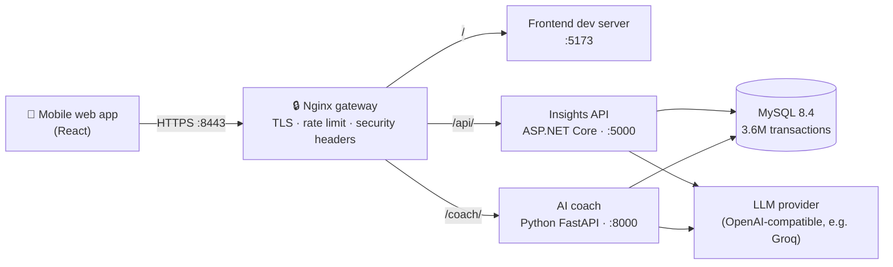

# Sisu Money Coach

**A kind AI money coach that helps you plan next month, instead of judging last month.**

Built in 48 hours at **Junction 2026** (Espoo, Finland) for the **S-Bank challenge**: an AI money coach that talks with the user about their own transactions, inside a mobile web app.

---

## What it does

- **Three baskets.** Every euro is sorted into **regular** (rent, bills), **irregular** (one-off purchases) and **leaks** (many small purchases in the same category).
- **Safe to spend.** Shows how much the user can safely spend this month, after upcoming bills and a safety buffer.
- **AI coach chat.** Quick question cards plus free conversation. Answers in about 1–2 seconds.
- **Money personality.** A K-means model groups 5,100 customers into 5 money styles (for example *Careful Saver* or *Little Treats Lover*).
- **Next-month forecast.** A weighted 3-month average plus the trend predicts next month's spending and the room left.

### Built for the user, not for the bank

- No ads, no loans, no product sales.
- All numbers come from SQL. The language model only puts verified numbers into words; it never invents figures.
- It never shames the user, and never suggests cutting health spending.
- It replies in the user's own language.

---

## Architecture



| Folder | What it is |
|---|---|
| [`PersonalEconomicCoach.Api/`](PersonalEconomicCoach.Api/) | ASP.NET Core (.NET 10) insights API: baskets, leaks, safe-to-spend, what-if, chat answers. See its own [README](PersonalEconomicCoach.Api/README.md). |
| [`coach-ai/`](coach-ai/) | Python FastAPI coach: K-means personality model, forecast, warm LLM replies with a template fallback. |
| [`infra/nginx/`](infra/nginx/) | Nginx reverse proxy config: HTTPS, HTTP→HTTPS redirect, rate limiting, security headers, routing. |

### Infrastructure and security highlights

- **One entry point.** The phone only talks to Nginx over HTTPS (TLS 1.2/1.3). Internal services are not exposed directly.
- **Rate limiting.** 10 requests per second per IP (burst 20); extra requests get `429`.
- **Security headers.** HSTS, `X-Content-Type-Options: nosniff`, `X-Frame-Options: DENY`, `Referrer-Policy: no-referrer`, `server_tokens off`.
- **Secrets stay on the server.** API keys and DB passwords live in .NET user-secrets and environment variables, never in the code or the frontend.
- **Parameterized SQL** everywhere (no string-built queries).
- **Everything in Docker:** MySQL, Nginx and the AI coach.

---

## Running it locally

> The S-Bank synthetic transaction dataset is challenge material and is **not included** in this repository.

### 1. MySQL

```bash
docker run --name spankki-mysql -e MYSQL_ROOT_PASSWORD=<your-password> -p 3307:3306 -v spankki-mysql-data:/var/lib/mysql -d mysql:8.4
```

Create the schema with [`PersonalEconomicCoach.Api/sql/schema.sql`](PersonalEconomicCoach.Api/sql/schema.sql) and load the dataset into the `transactions` table (see [`sql/README.md`](PersonalEconomicCoach.Api/sql/README.md)).

### 2. Insights API (C#)

```bash
cd PersonalEconomicCoach.Api
dotnet user-secrets set "ConnectionStrings:Default" "Server=localhost;Port=3307;Database=spankki;User ID=root;Password=<your-password>"
dotnet user-secrets set "Ai:BaseUrl" "https://api.groq.com/openai/v1/"
dotnet user-secrets set "Ai:Model" "openai/gpt-oss-120b"
dotnet user-secrets set "Ai:MaxOutputTokens" "1500"
dotnet user-secrets set "Ai:ApiKey" "<your-api-key>"
dotnet run --urls "http://0.0.0.0:5000"
```

`App:DemoToday` in `appsettings.json` is set to `2026-09-30`, the last day of the dataset, so month-based insights are filled. Leave it empty to use the real date.

### 3. AI coach (Python)

```bash
cd coach-ai
docker build -t spankki-coach .
docker run --name spankki-coach -p 8000:8000 \
  -e DB_HOST=host.docker.internal -e DB_PORT=3307 -e DB_USER=root -e DB_PASSWORD=<your-password> -e DB_NAME=spankki \
  -e OPENAI_API_KEY=<your-api-key> -e AI_BASE_URL=https://api.groq.com/openai/v1 -e AI_MODEL=openai/gpt-oss-120b \
  -d spankki-coach
```

Without an API key the coach still works and answers with a warm template reply (`"source": "template"`).

### 4. Nginx gateway

Create a self-signed certificate for the demo (it is git-ignored, never commit it):

```bash
docker run --rm -v ./infra/nginx/certs:/certs alpine/openssl req -x509 -nodes -newkey rsa:2048 -days 7 \
  -keyout /certs/spankki.key -out /certs/spankki.crt -subj "/CN=spankki.local"
docker run --name spankki-nginx -p 8080:80 -p 8443:443 \
  -v ./infra/nginx/spankki.conf:/etc/nginx/conf.d/default.conf:ro \
  -v ./infra/nginx/certs:/etc/nginx/certs:ro -d nginx:1.27
```

Update the `location /` address in `spankki.conf` to point to the machine that runs the frontend. Then open `https://<your-ip>:8443`.

### Quick checks

| URL | Expected |
|---|---|
| `https://localhost:8443/health` | API is up |
| `https://localhost:8443/api/insights/baskets` | Regular / irregular / leaks for the demo month |
| `https://localhost:8443/coach/health` | `"ai_enabled": true` when a key is set |

---

## Main endpoints

**Insights API** (behind `/api/`): `GET /insights/baskets`, `/insights/leaks`, `/insights/safe-to-spend`, `/insights/comparison`, `/insights/what-if`, `POST /ask`, plus `/accounts`, `/transactions`, `/events`, `/plan`, `/conversations`.

**AI coach** (behind `/coach/`):

```http
POST /coach/advice
Content-Type: application/json

{ "customer_id": "CUST00001", "message": "How can I feel calmer about money next month?", "history": [] }
```

Response: `{ "reply": "...", "source": "ai" | "template", "facts": { ... } }`

---

## Team

| Who | Role |
|---|---|
| **Yagmur Erocagi** ([@yagmur-ero](https://github.com/yagmur-ero)) | Infrastructure (Docker, MySQL, Nginx, HTTPS, rate limiting), Python AI coach, backend fixes and MySQL migration |
| **Yasaman Fattahi** | Mobile web app (React) |

### Credits

The first version of the insights API in `PersonalEconomicCoach.Api` was written by [@sevvalgn](https://github.com/sevvalgn) during the hackathon.

## License

All Junction 2026 project submissions are licensed under the [MIT License](https://opensource.org/license/mit). The S-Bank dataset and partner materials remain subject to the partner's terms.
